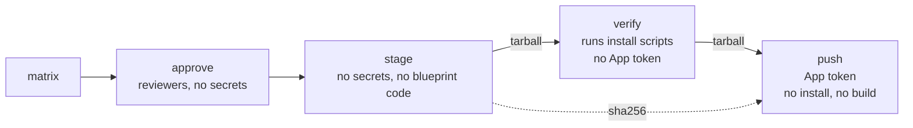
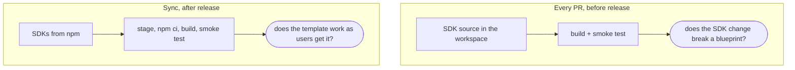
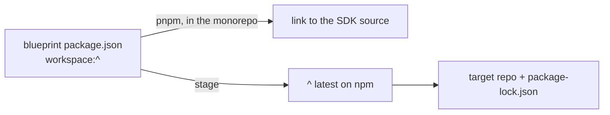

# ADR-0022: Sync Blueprints from the Monorepo

**Status:** Accepted  
**Date:** 2026-10-15

## Context

`storyblok create` scaffolds projects from public template repos (`storyblok/blueprint-core-*`,
`storyblok/blueprint-business-*`). Each lived on its own, with its own Dependabot and pinned
`@storyblok/*` versions, and nothing checked that it still worked with the SDKs released from here.
Users of these repos want a plain npm project: no CI config, no test tooling.

Terms:

- **Blueprint:** the source folder `blueprints/<repo-name>/` in this repo.
- **Target:** the template repo `storyblok/<repo-name>` that the sync pushes a blueprint to.
- **Smoke test:** a browser test of the demo story. No page errors or `console.error`, the demo
  content rendered, and hydration for Next.js, Nuxt and Svelte. `verify` runs it on a staged tree,
  `nx smoke` on the workspace.

Four challenges shape the design:

1. **Trust.** Verifying a template means installing its dependencies, which runs third-party install
   scripts. Those scripts must never reach the GitHub App token, and must not change what is pushed.
2. **Two questions.** "Does an SDK change break a blueprint?" is answered against the workspace
   source, before release. "Does the template install and run as users get it?" is answered against
   npm, after release. Neither one replaces the other.
3. **What ships.** A target is a plain npm project, not a copy of a monorepo folder.
4. **Cost.** Making blueprints workspace members costs a trust-policy exception, a `.pnpmfile.cjs`
   hook, and some care with the lockfile. It pays off only if CI uses it.

## Decision

**Blueprint sources live in `blueprints/<repo-name>/` as pnpm workspace members and nx projects. A
`blueprints` job smoke-tests the affected ones against the workspace SDK source on every PR.
`.github/workflows/sync-blueprints.yaml` verifies each one as users get it, and only then pushes it
to `main` of its target.**

### 1. Keep untrusted code away from the token

- **Five jobs: `matrix → approve → stage → verify → push`.** `approve` waits for the reviewers of
  the `production` environment. It is one job so that reviewers are asked once, not once per
  blueprint.
- **`stage` builds a tarball from this repo** with no secrets and no blueprint code, and outputs its
  sha256. Only `stage` can set that output. It is one job for all blueprints, because the outputs of
  matrix legs overwrite each other.
- **`verify` runs the untrusted code:** `npm ci`, the build, and the smoke test. It references no
  App secret, uses no environment, and sets `cache: "false"`. The read-only demo token is a
  repository variable, which install scripts can read. It is in every template's build anyway.
- **`push` holds the token** (environment `blueprint-sync`, `main` only). It checks the tarball
  against the sha256, unpacks it into an empty directory, refuses a `.git` in it, and runs git
  without hooks and fsmonitor. It runs no install, build, or blueprint code, and the token is used
  only by the target checkout and the `git push` step, which run before or without blueprint
  content. A compromised `verify` can replace the tarball, but cannot get a changed one past `push`:
  it can only fail the sync.
- **A token per matrix leg**, scoped to one target repo with `contents: write`. Commits are authored
  as `storyblok-bot <bot@storyblok.com>`: the token authorizes the push, not the identity.
- **No going back in time.** When the target's last commit is a sync commit, `push` fails unless the
  commit being synced is ahead of it or identical. A direct commit on top of a sync turns the check
  off.
- **Deploy from `main` only.** Both environments must, because a branch brings its own copy of the
  workflow and the ref check alone would not be a barrier (`blueprints/README.md`).

### 2. Ask two questions

- **The `blueprints` job in `ci.yaml`** runs on pull requests and pushes to the same branches as
  `build`. It builds and smoke-tests only the blueprints `nx affected` selects: a PR that touches an
  SDK, a package it depends on, or a blueprint's own files, never all seven unconditionally. It
  skips the nx cache (see below).
- **The smoke test is the one `verify` uses** (`tools/blueprint-sync`), run against the workspace
  instead of a staged tree: no `stage`, no `npm install`, no lockfile.
- **`verify` runs on every sync**, because change detection needs the target checkout, which belongs
  to `push`. A red run never touches a target.
- **Affected base:** `nrwl/nx-set-shas`, pinned to a commit. For pull requests it is the merge base
  with the target branch, for pushes the last commit whose CI run passed on the pushed branch, so a
  failed commit is not forgotten. `main-branch-name` is the PR's target or the pushed branch, so
  other branches read their own history, and a branch without a passed run falls back to its
  previous commit. The job grants `actions: read` for the run history. The demo token reaches only
  the smoke step.

### 3. Ship a plain npm project

- **The folder name is the repo name**, so repo names are searchable here.
- **The target mirrors the folder**, dotfiles included, minus what its `.gitignore` ignores, minus
  `project.json`, `AGENTS.template.md` and the `nx` key of `package.json`. A test over the real
  blueprints fails if any reaches a target. Nothing is added: no `.github` (the targets have no CI,
  and the App cannot push workflow files), no releases, no tags. Three files are generated:
  - `package.json`, with `workspace:^` resolved to `^<latest on npm>` (ADR-0014), not to the
    workspace version. That can be ahead of npm between a release merge and its publish, and then
    resolves to nothing (`ETARGET`). With npm's `latest`, a sync in that window ships the previous
    release.
  - `AGENTS.md`, composed from `AGENTS.template.md`: the blueprint's framework part, then
    `blueprints/AGENTS.storyblok.md`. A block a framework maintains itself (Next.js) stays unchanged
    at the top. The sync fails when it mentions an npm script `package.json` lacks.
  - `package-lock.json`, resolved by `stage` before any blueprint code runs. npm 10 crashes on the
    Angular and Nuxt blueprints without one. `verify` tests that file, so the lockfile tested is the
    lockfile shipped. No lockfile is committed here: it could not be validated against `workspace:^`
    and would go stale on each release.
- **The commit is `chore: sync (source: <sha>)`**, or nothing when nothing changed. A sync that only
  moves the lockfile is skipped: it moves whenever a dependency publishes, and ships with the next
  change to the template.

### 4. Pay the workspace cost

- **`blueprints/*` is a workspace glob**, so `workspace:^` resolves to the SDK source locally and
  the root lockfile covers blueprint dependencies.
- **Trust-policy exceptions (ADR-0015):** `trustPolicyIgnoreAfter: 43200` (30 days) clears false
  positives on old releases, workspace-wide, while newer versions are still checked.
  `trustPolicyExclude` pins the one genuine downgrade, `@netlify/serverless-functions-api@2.24.0`.
  `blueprints/.pnpmfile.cjs` drops the Nuxt blueprint's `postinstall` in the workspace only, because
  `nuxt prepare` needs `@storyblok/nuxt`, which is not built during install.
- **Workspace packages take `vue` from the catalog.** With `injectWorkspacePackages`, a blueprint
  that makes the lockfile resolve a second version of a peer turns `link:` dependencies between
  workspace packages into injected `file:` copies. Those have no `dist` after a fresh install when
  the nx cache restores an SDK build, which breaks the dependents' tests. A blueprint declaring a
  `vue` above the catalog's did this to `packages/nuxt`. When a lockfile diff turns a `link:` into a
  `file:`, raise the catalog.
- **The `blueprints` job skips the nx cache** for the same reason: pnpm refreshes a blueprint's
  injected SDK copy only when the SDK's `build` script runs, and a cache hit does not run it.
- **nx treats each blueprint as a project** with the tag `blueprint`. The root `build` script and
  the `build` job exclude the tag, so `-p="*"` does not start seven framework builds. The root
  `oxlint` and `vp fmt` skip blueprints, which ship their own ESLint and Prettier config. How the
  projects are inferred and what a new blueprint needs: `blueprints/README.md`.

### 5. Operate it

- **Manual, from `main` only.** `publish.yaml` chains the sync after a publish on `main`. Other
  branches publish prereleases, which a template must never point at, so the workflow fails on any
  other ref.
- **One sync at a time.** Concurrency is scoped by ref and never cancels a running sync. A run
  waiting behind it is replaced by a newer one.

## Alternatives Considered

- **PR to the target with CI there, auto-merged.** Rejected: puts `.github` and Playwright in every
  user's project, and a red PR left open is a stale template.
- **Blueprints outside the workspace, resolved with `pnpm pack`.** Tried first and rejected: adding
  them re-resolved the monorepo lockfile, moved existing packages, and failed `trustPolicy` on old
  versions from existing tooling. Workspace membership accepts the churn and the exceptions instead,
  because the PR job needs the SDK source link.
- **A personal access token.** Rejected: long-lived, tied to a person, and scoped to all they can
  reach.
- **`npm install` without a lockfile in the job that holds the App token.** Tried first and
  rejected: an install script could plant a `pre-commit` hook in the target checkout or append to
  `$GITHUB_ENV`, and the next step ran with the token. Handing `push` a tarball from the job that
  ran the install scripts was not enough either, hence the sha256 from `stage`.
- **Lockfiles committed in the targets, or in this repo.** Rejected: they go stale.
- **Leave blueprints out of nx** and add a PR workflow that runs `stage` and `verify`. Tests what
  users get, but never the SDK source in the PR.
- **Build only, no smoke test, in the PR job.** Cheaper, but a compile-clean SDK change can still
  break hydration or the editor attributes.
- **Run the blueprints in the existing `build` job.** Least config, but every PR pays for seven
  framework builds and the main job needs the demo token.

## Consequences

**Benefits**

- SDK changes that break a blueprint fail the PR, not the post-release sync. PRs that touch an SDK
  take longer, by the affected blueprints' builds and smoke tests.
- This repo owns blueprint dependency updates.

**Trade-offs we accept**

- Lockfile churn in the workspace when a blueprint dependency moves. A new install script in a
  blueprint fails the workspace install until classified (ADR-0015).
- The targets hold a lockfile that ages between syncs, like any template without an updater. There
  is no Dependabot or Renovate config yet, and the first sync deletes the targets'
  `.github/dependabot.yml`, so a break from a floating dependency shows only at the next sync.
- One red `verify` leg blocks every blueprint's push, and a failing `stage` blocks the run: `needs`
  on a matrix job requires all legs. A red leg means something shared is broken, and syncing a
  single blueprint works around it.
- `verify` runs after the release. A blueprint that needs an unreleased SDK change passes PR CI and
  fails the sync until the release. Sync the other blueprints by name, or release first.
- `stage` and `verify` need npm 11 or newer (Node 24). If `storyblok create` changes, the `verify`
  config must follow.
- Commits made directly in a target are overwritten by the next sync, and the job does not check for
  them.
- The sync is live when `publish.yaml` merges: it asks for an approval after every publish on
  `main`, and has no off-switch. The first sync after the merge is run by hand: reject the first
  chained approval.

**Known gaps**

- **Install scripts can write caches.** `verify` runs them with the read-only demo token and
  whatever else the job's runtime reaches. That includes Actions caches in the scope of `main`,
  which `cache: "false"` does not prevent. CI jobs that restore caches are exposed, because the
  cache action's `restore-keys` fallback takes the newest entry. Running `verify` in a container or
  as an unprivileged user would close it.
- **No release-age window on the lockfile.** The workspace waits 24 hours for a new release, but the
  lockfile pins whatever npm serves at sync time. The sync runs right after a publish and needs the
  `@storyblok/*` version just released: with `--min-release-age=1`, npm fails with `ETARGET` for it.
  npm 11 has `min-release-age` but no exclude option, which arrives in npm 12 as
  `min-release-age-exclude`. So the window waits until CI has npm 12, then
  `--min-release-age=1 --min-release-age-exclude=@storyblok/*`. Until then the smoke test is the
  only gate on third-party releases.
- **Gaps in the PR job.** A PR that only changes Markdown skips the `blueprints` job, so an
  `AGENTS.template.md` that names a missing npm script fails at the sync. A change that only touches
  `pnpm-lock.yaml` selects no blueprint. `nx.json` is in `.nxignore`, so editing the smoke default
  or the named input selects nothing: run `pnpm nx smoke <blueprint>` by hand. "Passed" for the
  affected base means the whole CI workflow run, so an unrelated red job keeps the base at an older
  commit. Renaming `ci.yaml` or the workflow resets that history.

## Follow-ups

Not decided, not in this change. Each closes a gap named above or in `blueprints/README.md` or
`tools/blueprint-sync/README.md`.

- **Contract test for `storyblok create`.** `verify` copies two behaviors of the CLI: the `.env` it
  writes and Angular's placeholder replacement. A test in `packages/cli` that runs the real
  functions against every blueprint would make a change to `create` fail here instead of passing
  silently.
- **Node 22 and npm 10.** `verify` runs on Node 24 with npm 11. Nothing runs `npm ci` and a build on
  what users on Node 22 have, and no blueprint declares `engines`.
- **Dev server.** Users are told `npm run dev`, but `verify` serves the build (Astro: the dev
  server), so the dev server of the other six and the editor bridge it carries are untested.
- **Release-age window** for the lockfile, once CI has npm 12.
- **Isolating `verify`:** a container or an unprivileged user.
- **Server-side rendering for Angular.** `ng build` prerenders no routes, so `serverRendered` is off
  in its config. Fixing the blueprint turns the server-rendering assertion on.
- **Cheaper PR jobs.** The job builds each affected blueprint twice (the token-free `build`, then
  the build inside `smoke`), and a change to a core SDK selects all seven. Dropping the first build
  and smoking a subset on PRs would cut the time.
- **A guard for implicit inputs.** A CI check that fails when `nx.json` changes without all seven
  blueprints selected.
- **Injected dependencies.** After switching branches, `smoke` needs `pnpm install` or
  `--skip-nx-cache` because of the hard-linked copies. A `smoke` that syncs them first would remove
  the footgun.
